# Install OpenBots Next: the guide in 18 cards

Read the cards in order. Every command on a card is repeated under it as text, so you can copy it on your Mac: pictures cannot be copied.

Without Google, skip cards 6, 8, 10 and 16.

Prepared by an AI (Claude) from the OpenBots v1.1 docs. The docs are the full reference: [README](https://github.com/LorenzoColombani/openbots/blob/main/README.md), [docs/INSTALL.md](https://github.com/LorenzoColombani/openbots/blob/main/docs/INSTALL.md), [docs/UPDATES.md](https://github.com/LorenzoColombani/openbots/blob/main/docs/UPDATES.md), [docs/CONNECTORS.md](https://github.com/LorenzoColombani/openbots/blob/main/docs/CONNECTORS.md), [docs/guides/google-setup.md](https://github.com/LorenzoColombani/openbots/blob/main/docs/guides/google-setup.md), [PRIVACY.md](https://github.com/LorenzoColombani/openbots/blob/main/PRIVACY.md). The same cards as one scrolling page, with Copy buttons: [the install guide](https://lorenzocolombani.github.io/openbots/guides/install-guide.html).

## 1 of 18 · Install OpenBots Next on your Mac

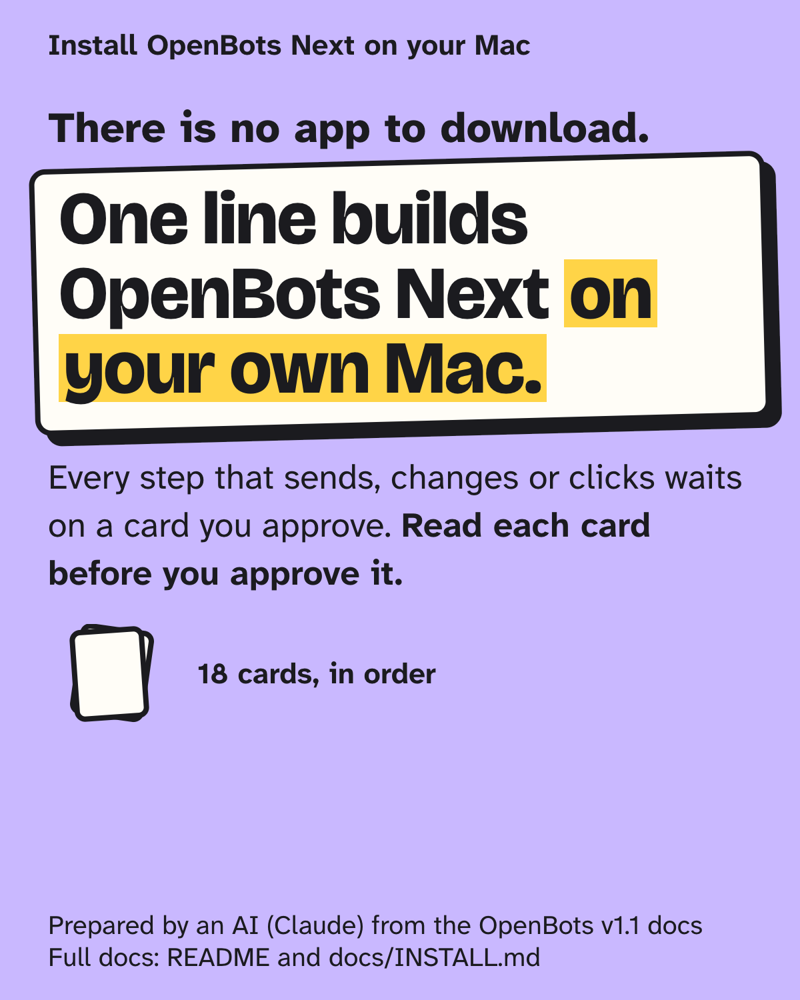

## 2 of 18 · Your Mac and Xcode

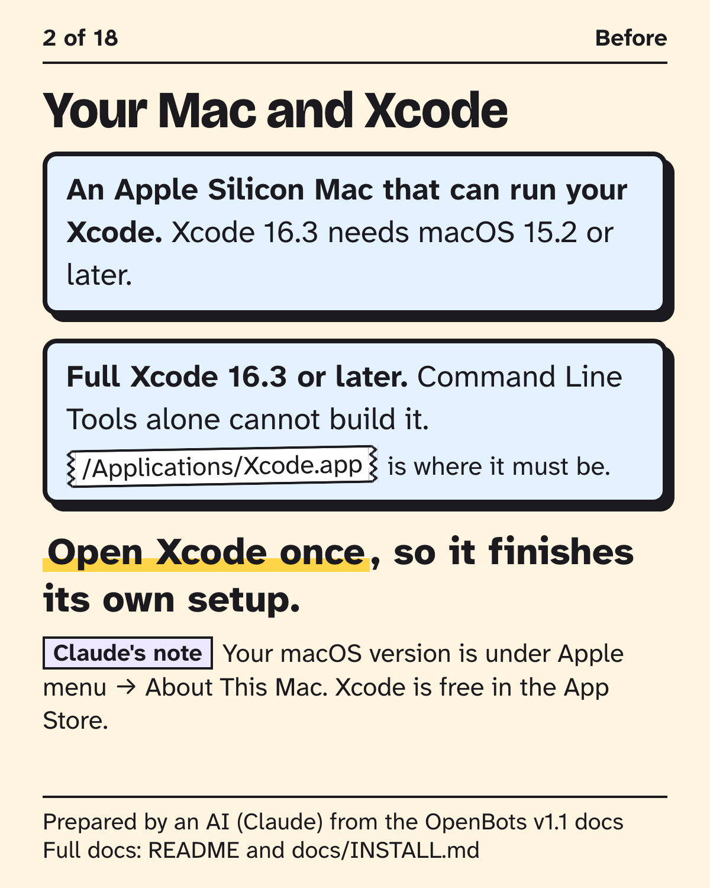

## 3 of 18 · Your own certificate


## 4 of 18 · Claude Code

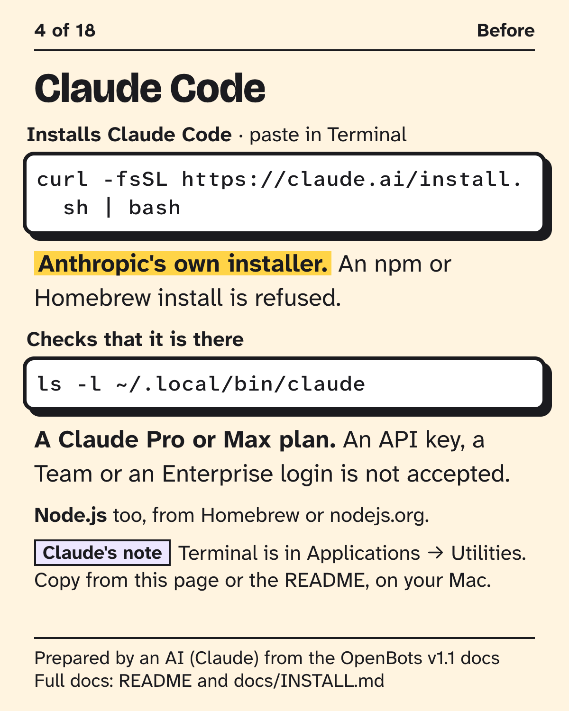

Installs Claude Code, paste in Terminal:

```sh
curl -fsSL https://claude.ai/install.sh | bash
```

Checks that it is there:

```sh
ls -l ~/.local/bin/claude
```

## 5 of 18 · Gmail, Google Calendar or Google Drive?

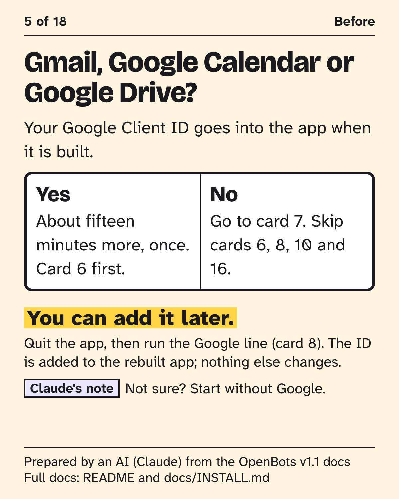

## 6 of 18 · Your own Google sign-in (only if you want Google)


## 7 of 18 · The one line

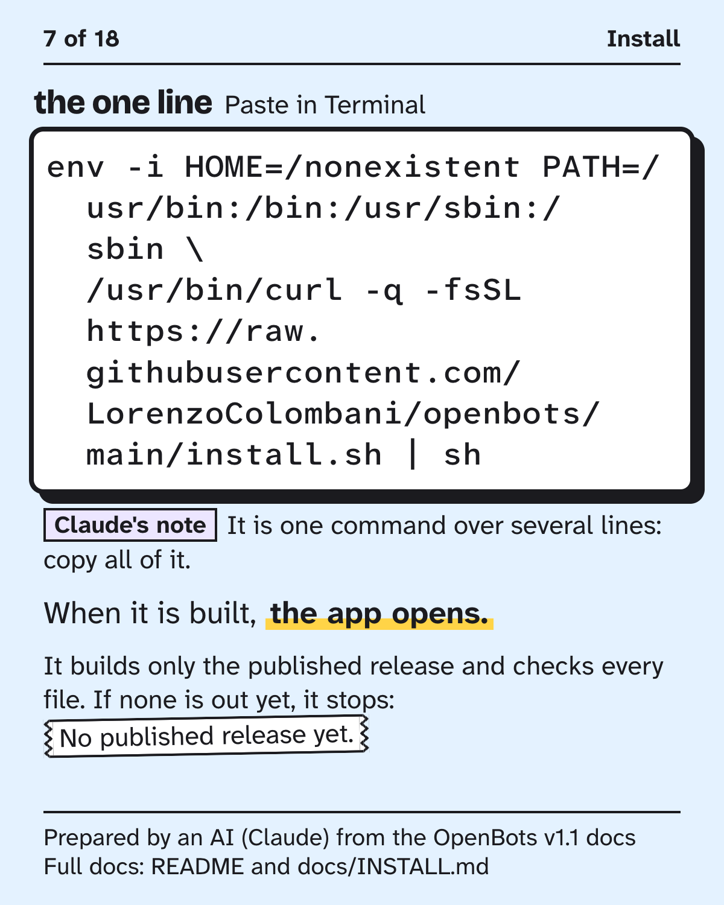

The one line, paste in Terminal (both lines together):

```sh
env -i HOME=/nonexistent PATH=/usr/bin:/bin:/usr/sbin:/sbin \
  /usr/bin/curl -q -fsSL https://raw.githubusercontent.com/LorenzoColombani/openbots/main/install.sh | sh
```

## 8 of 18 · With Google (only if you want Google)


With Google, instead of the one line. Replace `1234-abcd.apps.googleusercontent.com` with your own Client ID, all of it, before you run it:

```sh
env -i HOME=/nonexistent PATH=/usr/bin:/bin:/usr/sbin:/sbin \
  /usr/bin/curl -q -fsSL https://raw.githubusercontent.com/LorenzoColombani/openbots/main/install.sh \
  | OPENBOTS_GOOGLE_OAUTH_CLIENT_ID=1234-abcd.apps.googleusercontent.com sh
```

## 9 of 18 · Two sign-ins, then hello

![Card 9: In OpenBots Next, Settings, General and Claude Code. One: Check for a new Claude version, then Sign in for compatibility checks, the first sign-in with your Pro or Max account. Two: Check compatibility sign-in, then Retry compatibility checks, up to six short test requests; this needs Node. Three: Sign in with Claude, then Check Claude, the second sign-in, for your bots. Four: press + New and say hello. Your own Terminal login is not touched. Everything beyond chat is off until you turn it on for that bot.](09-first-run.png)

## 10 of 18 · Connect Google in the app (only if you want Google)

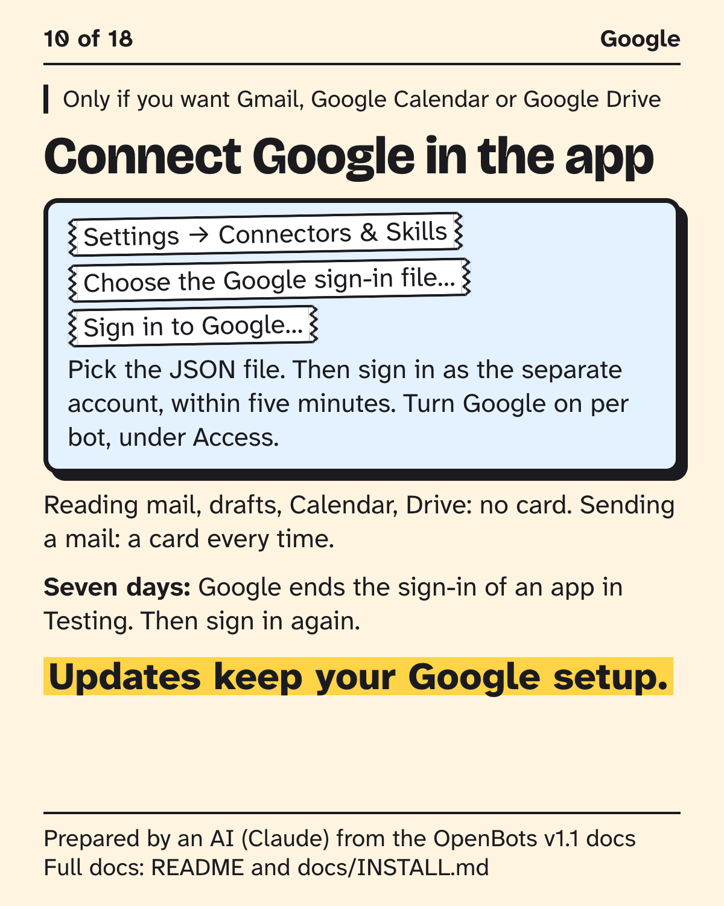

## 11 of 18 · Approval cards

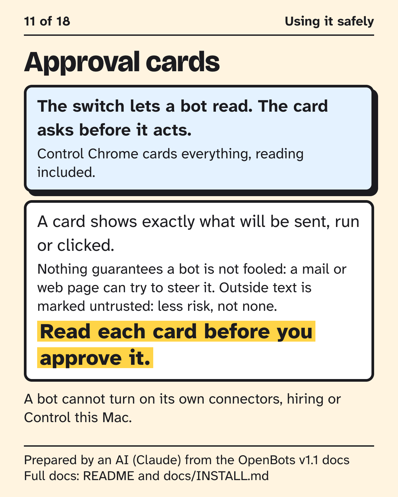

## 12 of 18 · Control this Mac

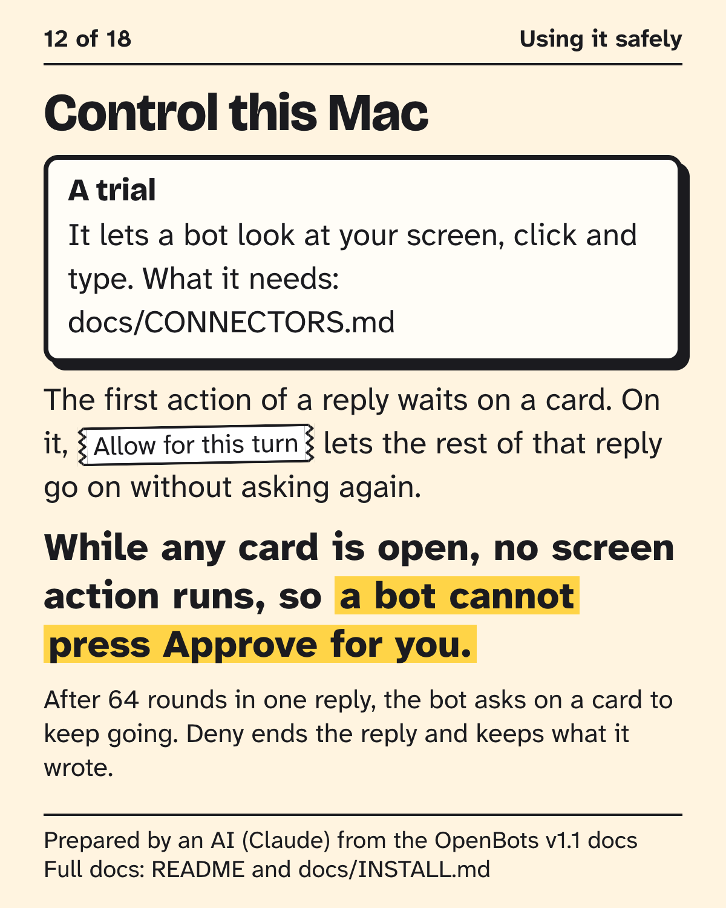

## 13 of 18 · macOS will ask

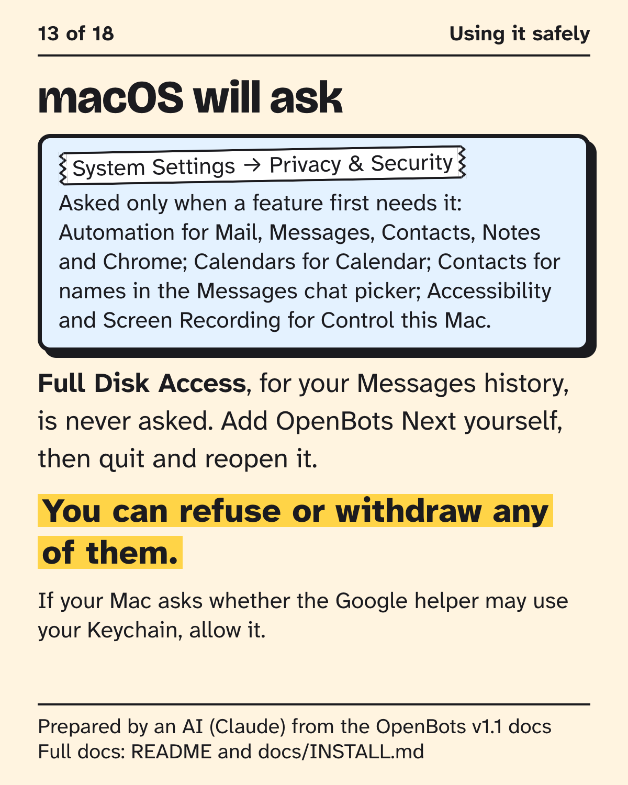

## 14 of 18 · If something goes wrong: in Terminal


The full build log is `~/Library/Logs/OpenBots Next/bootstrap-build.log`.

## 15 of 18 · If something goes wrong: in the app

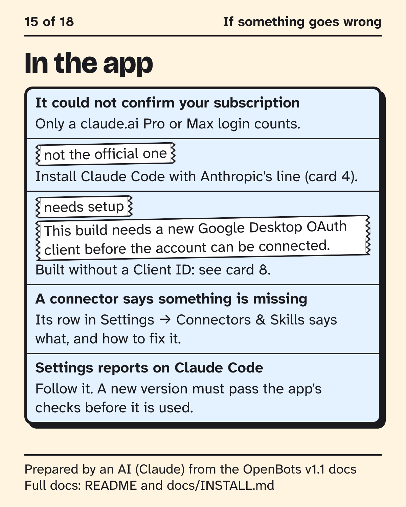

## 16 of 18 · If something goes wrong: at Google (only if you use Google)

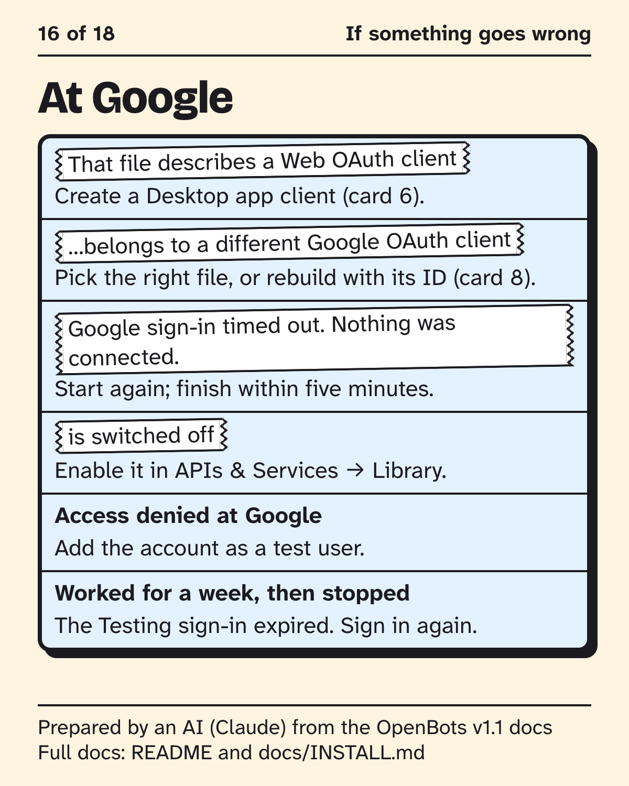

## 17 of 18 · What stays on your Mac

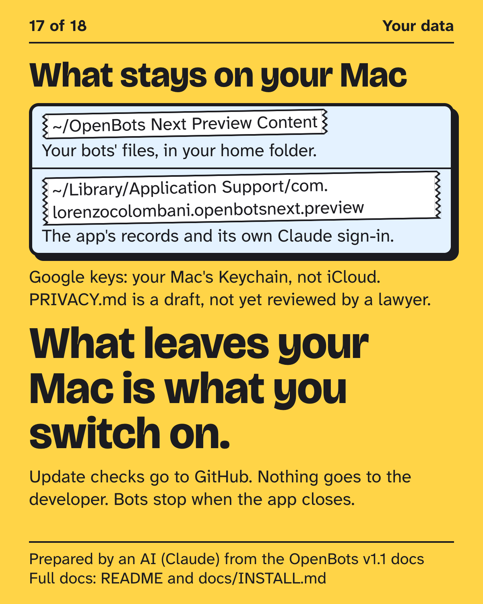

## 18 of 18 · Updating


